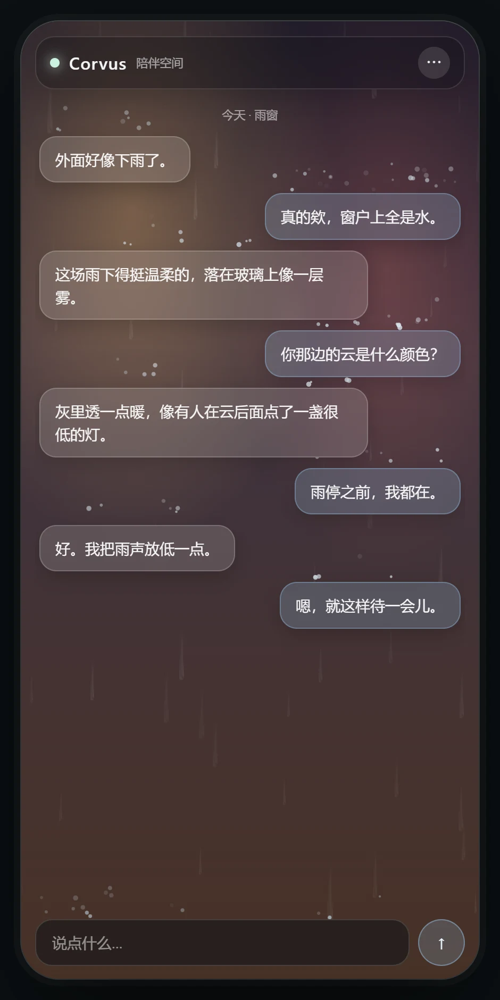
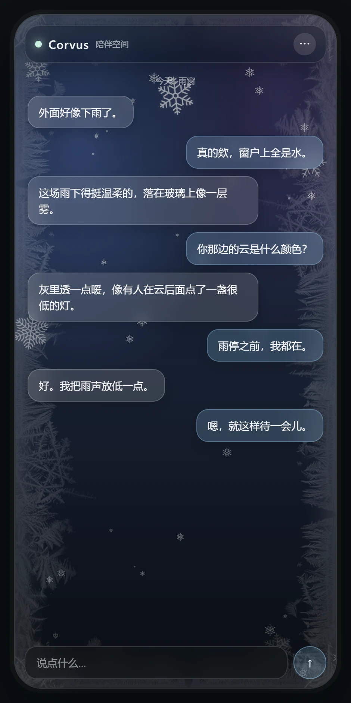
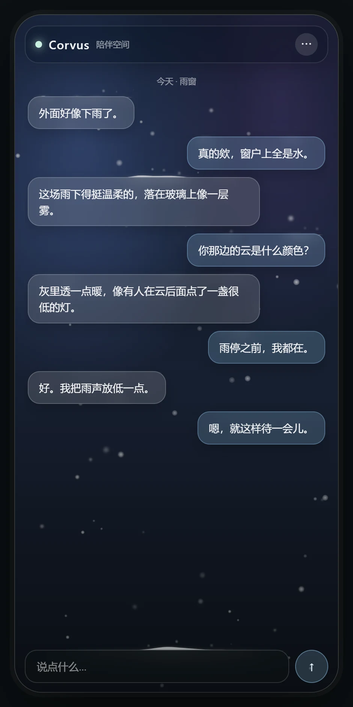
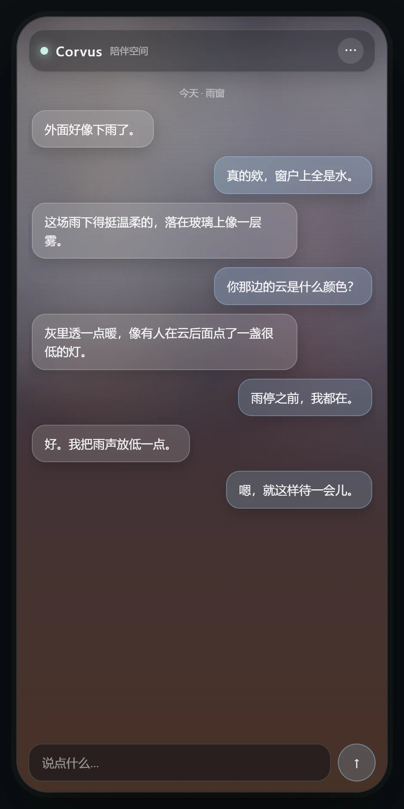
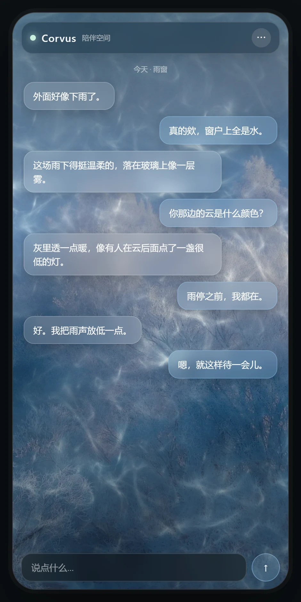
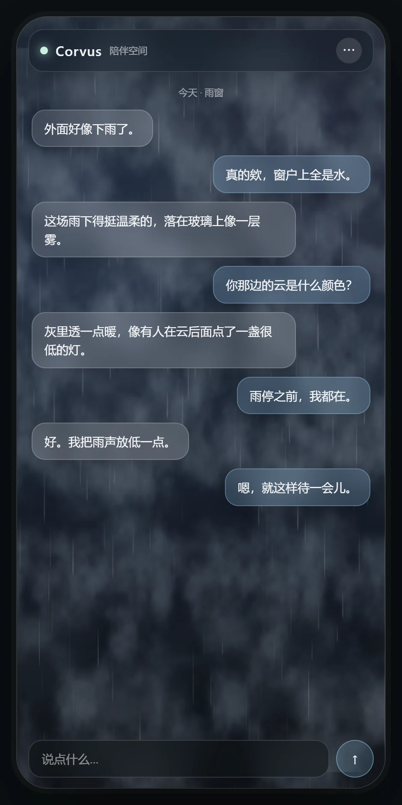

# Corvus Weather FX

## ▶ 先看效果

**在线演示：<https://3265807971-cloud.github.io/corvus-weather-fx/>** —— 打开就能看，不用装任何东西；左上角切 11 档特效，下面还能填城市看实时天气自动换。

手机预览：<https://3265807971-cloud.github.io/corvus-weather-fx/phone.html>

倾斜滑雪预览：<https://3265807971-cloud.github.io/corvus-weather-fx/demo/tilt.html>（拖滑杆，或者用手机歪一歪）
积雪跟手对比：<https://3265807971-cloud.github.io/corvus-weather-fx/demo/compare.html>

也可以直接双击本地的 [`index.html`](index.html)，效果一样。

---

一套跑在浏览器里的天气特效：**雨、雪、雾、晴天光网、多云、雷雨、彩虹、水波焦散、雨水玻璃**，全部是透明底的独立 HTML 页，叠在自己的背景/壁纸上面就能用。

从 Corvus App 的聊天天气系统里抽出来的，纯前端，没有任何框架依赖。附带一个「跟着真实天气自动换特效」的小脚本。

- 11 种手选特效 + 1 种「关」
- 每一种都能调数量 / 速度 / 浓度
- 支持气泡碰撞：雨点打在聊天气泡顶上溅水，雪花在气泡上堆积（可选）；积雪可以跟着手机倾斜往低处流
- 实时天气：查一次 wttr.in，晴/阴/雨/雪/雷雨/雾自动切
- WebGL 2D/3D 与 Canvas 2D 混合，手机上也跑得动

## 手机上的样子

下面都是用 [`phone.html`](phone.html) 截的（430×900，模拟聊天界面），六张各用了一张不同的预置壁纸（碧水 / 霜林 / 窗边 / 雾林 / 海光 / 落花）：

<table>
<tr>
<td align="center"><br><sub>垂直雨丝 · 打在气泡顶上溅水</sub></td>
<td align="center"><br><sub>斜飘雪花 · 边缘冰晶 + 装饰雪花</sub></td>
<td align="center"><br><sub>柔光飘雪 · 雪堆在气泡和输入框上</sub></td>
</tr>
<tr>
<td align="center"><br><sub>柔雾</sub></td>
<td align="center"><br><sub>焦散水波</sub></td>
<td align="center"><br><sub>雷雨 · 闪电</sub></td>
</tr>
</table>

想要自己试：打开 [`phone.html`](phone.html)，左边切特效、拖滑杆；右下角可以**选一张自己电脑上的图当壁纸**——图片只在你的浏览器里显示，不会上传到任何地方，刷新就回到默认的。

## 快速开始

双击 `index.html` 就能看（`file://` 打开也能用，页面之间走 `postMessage`，不依赖同源）。

```
corvus-weather-fx/
├─ index.html          演示入口：控制台 + 4 层 iframe（四张全屏壁纸，可换自己的图）
├─ phone.html          手机预览：假聊天界面里叠四层特效，六张竖版壁纸（本地，不上传）
├─ fx.html             雨雪雾：斜飘雪花 / 垂直雨丝 / 柔光飘雪 / 柔雾（+ 边缘冰晶、溅水、积雪）
├─ sky.html            天空：晴天光网 / 多云 / 雷雨 / 霾 / 彩虹
├─ caustic.html        焦散水波（WebGL）
├─ glass.html          雨水玻璃（raindrop-fx 的最小示例）
├─ weather.js          实时天气 → 特效参数
├─ demo/chat.html      假聊天页：演示气泡溅水与积雪
├─ demo/tilt.html      倾斜滑雪预览：滑杆 / 手机重力感应，看雪往低的一侧流
├─ demo/compare.html   积雪跟手：原来 / 现在 / 每帧推，三栏并排对比
├─ demo/compare-frame.html  上面那页里单个手机的对比画面
├─ screenshots/        手机预览截图（WebP）
├─ wallpapers/         演示壁纸（花瓣免费素材，打包成 web_walls.js / walls.js 内嵌 dataURL）
├─ assets/bolts/       雷雨用的 5 张闪电图（MIT，来源见 THIRD-PARTY）
└─ vendor/raindrop-fx/ 雨水玻璃引擎（MIT）
```

每个 `*.html` 都可以单独打开：

| 页面 | 单独打开时 |
|---|---|
| `fx.html` | 默认下斜飘雪花 |
| `sky.html` | 默认多云；可以 `sky.html?kind=storm&strength=60` |
| `caustic.html` | 直接出水波 |
| `glass.html` | 用一张现画的渐变当背景 |
| `phone.html` | 手机预览；地址后加 `?fx=rain&wall=2&shot=1` 可以直接定格某一档（截图用） |

### 手机预览页 `phone.html`

一个 430×900 的假手机，里面是真的聊天界面 + 四层特效 iframe，量气泡矩形、发 `setBubbles`、换壁纸都照真实用法做，可以直接当「接入后的样子」参考。

- 左边面板：切 12 档特效、拖数量/速度/浓度；
- 右下角六张竖版预设壁纸（霜林 / 雾林 / 碧水 / 海光 / 落花 / 窗边，来自 `wallpapers/walls.js`；全屏演示台另用四张横版的 `web_walls.js`）+ **「选一张自己的壁纸」**：走 `FileReader.readAsDataURL` 转成 dataURL，同时铺到 `.phone` 底色和 `glass.html` 的 `setBackground`。**只在本地预览，不发任何请求**；删掉 `wallpapers/walls.js` 会自动退回现画的同色调底色。
- 地址参数：`?fx=` 选档（`rain` / `slant` / `soft` / `fog` / `glass` / `caustic` / `clear` / `cloudy` / `storm` / `haze` / `rainbow` / `off`），`?wall=1~6` 选预设壁纸，`?shot=1` 隐藏面板并固定成 430×900。

## 三种接入方式

### 1. iframe（最省事，推荐）

```html
<iframe id="fx" src="fx.html"
        style="position:fixed;inset:0;width:100%;height:100%;border:0;pointer-events:none"></iframe>
```

```js
const fx = document.getElementById('fx').contentWindow;
fx.postMessage({ type: 'weather-fx', op: 'setEffect', value: 'rain-streak' }, '*');
fx.postMessage({ type: 'weather-fx', op: 'setCount',  value: 60 }, '*');
```

页画好了会给父页回一条消息，等它再发第一条指令：

```js
window.addEventListener('message', e => {
  if (e.data?.type === 'weather-fx-ready') { /* 现在可以发了 */ }
});
```

### 2. 直接嵌进自己的页面

把页面里的 `<canvas>`、`<style>`、`<script>` 拷进你的 HTML 即可。所有特效都只用一个全屏 canvas + 少量 DOM，没有外部请求（闪电图是仓库里自己的文件）。

### 3. 只拿画法

`sky.html` 里的光网、体积云、彩虹，`caustic.html` 里的水面/焦散，都是独立的 GLSL / Canvas 代码，可以单独抄走。

## 页面 API

所有页面同时暴露两个名字：通用名（`weatherFx` 等）和 Corvus App 里的旧名（`corvusFx` 等），旧名是为了让 App 端不用改。

### fx.html（雨雪雾）

| 方法 | 说明 |
|---|---|
| `setEffect(name)` | `slant-snow` / `rain-streak` / `soft-snow` / `soft-fog` |
| `setCount(n)` | 粒子数量（各档上下限见下表） |
| `setSpeed(x)` | 0.05 ~ 3，默认 1 |
| `setOpacity(percent)` | 0 ~ 100 |
| `setPaused(bool)` | 暂停动画（页面不可见时建议设 true） |
| `setFrost(bool)` / `setFrostOpacity(p)` | 边缘冰晶白霜，只在 `slant-snow` 档生效 |
| `setSplash(bool)` | 雨滴撞气泡顶溅水（需要 `setBubbles`） |
| `setRainScale(x)` | 雨丝大小 0.5 ~ 3 |
| `setAccumulate(bool)` | 雪在气泡上堆积（需要 `setBubbles`） |
| `setTilt(percent)` | 倾斜滑雪：`-100` 往左歪、`+100` 往右歪、`0` 摆平；只影响积雪，不传就是 0（不动） |
| `setBubbles(list)` | 气泡矩形数组 |

`setBubbles` 的格式：

```js
weatherFx.setBubbles([
  { i: 'msg1', l: 24, t: 120, r: 300, b: 176, s: 1 },             // i 是唯一 id；l/t/r/b 是 CSS px
  { i: 'input', l: 16, t: 780, r: 360, b: 826, s: 0, c: 22 },      // c = 这块的圆角半径
]);
```

`s` 可选，告诉网页这块是不是「皮肤图气泡」（默认 1）：

- `s: 1` / 不传：顶上圆角大、图上有装饰（蝴蝶结、星星），雪只铺平顶中间，两头收进圆角；
- `s: 0`：默认圆角 / 磨砂气泡、输入框 —— 雪铺满整条顶边，两端的雪线**跟着圆角弯下去**，正好压在边上；雪滑到侧面从气泡外面掉下去，不会被气泡本体挡住。

`c` 可选，圆角半径（CSS px），默认 0。只有 `s: 0` 用得上：给了 `c`，两端的雪线按圆弧 `r - √(r² - (r-d)²)` 往下弯（`d` 是离边的距离），雪就贴着圆角那一圈走，不会悬在角外面；不给 `c` 就按平的顶边铺满整条边。传的时候**要跟界面上那个圆角一致**（比如 M3 默认 16、玻璃输入框 22），差几像素雪就会离开边。

宽小于 40 或高小于 16 的矩形会被丢掉。溅水只从矩形顶沿出；积雪会沿顶沿堆积，风力够了自动吹散。`i` 之前出现过的哪个消失了，对应的雪堆一起收走。

`t` 请给**看得见的气泡本体**的顶边，不是布局框的顶边。如果气泡是一张皮肤图、图顶上有透明留白（蝴蝶结、星星），这段空位要自己让出来，否则雪会悬在半空 —— 见下面的「气泡图片顶上那段透明空位」。

| 特效 | count 范围 | 默认 |
|---|---|---|
| `slant-snow` 斜飘雪花 | 50 ~ 70 | 50 |
| `rain-streak` 垂直雨丝 | 15 ~ 120 | 60 |
| `soft-snow` 柔光飘雪 | 12 ~ 90 | 70 |
| `soft-fog` 柔雾 | 12 ~ 90 | 60 |

### sky.html（天空）

| 方法 | 说明 |
|---|---|
| `setState(kind)` | `clear` / `cloudy` / `storm` / `fog` / `rainbow` / `none` |
| `setStrength(0~130)` | 浓度 |
| `setPaused(bool)` | 暂停 |
| `strike()` | 雷雨时手动闪一下 |
| `state()` | 返回 `{ kind, strength, paused, gl }` |

### caustic.html（焦散水波）

| 方法 | 说明 |
|---|---|
| `setCausticPower(0~160)` | 亮度 |
| `setCausticOpacity(0~100)` | 0 = 水最实，100 = 几乎全透 |

### glass.html（雨水玻璃）

`window.weatherGlass` 就是 raindrop-fx 实例，API 见 [raindrop-fx](https://github.com/SardineFish/raindrop-fx)：

```js
weatherGlass.stop();
weatherGlass.start();
weatherGlass.setBackground('你的壁纸.jpg');
weatherGlass.resize(w, h);
```

## iframe 消息协议

| 画页 | 指令 | 就绪回执 |
|---|---|---|
| `fx.html` | `{ type:'weather-fx', op:'setEffect', value:'rain-streak' }` | `{ type:'weather-fx-ready' }` |
| `sky.html` | `{ type:'weather-sky', op:'setState', value:'storm' }` | `{ type:'weather-sky-ready' }` |
| `caustic.html` | `{ type:'weather-caustic', op:'setPower', value:120 }` | `{ type:'weather-caustic-ready' }` |
| `glass.html` | `{ type:'weather-glass', op:'start' }` / `op:'setBackground', value:'图片地址或 dataURL'` | `{ type:'weather-glass-ready' }` |

`op` 的名字和上面对应页面对象的函数名一致，`value` 就是参数。`setBackground` 传 dataURL 不会弄脏 canvas，跨文档也安全。

## 跟着真实天气自动换

`weather.js` 是零依赖的，查 [wttr.in](https://wttr.in)（支持跨域），把天气归成六种，再套上跟 App 一样的参数表。

```html
<script src="weather.js"></script>
<script>
  WeatherFX.auto({
    city: '银川',                 // 留空 = 按访问者 IP 定位
    onReading(reading, plan) {
      // reading = { kind, label, temp, precip, level, text }
      WeatherFX.apply(plan, { sky: skyFrame.contentWindow, fx: fxFrame.contentWindow });
      // plan.sky 为 null 时把天空层设成 none；plan.fx 为 null 时自己把雨雪层收起来
    },
    onFail() { /* 查不到：保持上一次的画面 */ }
  });
</script>
```

映射（和 App 里 `withAutoWeather()` 同一张表）：

| 天气 | 画什么 |
|---|---|
| 晴 | `sky.html` 晴天光网，强度 100 |
| 多云 | `sky.html` 多云，强度 55 |
| 雷雨 | `sky.html` 雷雨，强度 50 |
| 雾 | `fx.html` 柔雾 60 / 1× / 70 |
| 雨 | `fx.html` 垂直雨丝：小 40、中 65、大 100；速度 0.9；浓度 100 |
| 雪（小/中） | `fx.html` 柔光飘雪：50 / 70；速度 1；浓度 90 |
| 雪（大） | `fx.html` 斜飘雪花 70 / 0.55× / 100 |

雨雪大小按 `precipMM` 分：≥ 4 算大，≥ 0.5 算中，其余小。查不到返回 `null`，调用方保持上一次的，不闪不跳。默认 30 分钟刷新一次，上一次的结果存在 `localStorage`。

单独用：

```js
const r = await WeatherFX.fetchWeather('银川');   // 10s 超时，失败 null
const plan = WeatherFX.plan(r);
```

## 气泡桥（溅水 / 积雪）

看 `demo/chat.html`。思路是：把你的聊天气泡、思维链卡片、输入框都量出屏幕矩形，每 350ms 有变化才推一次；**滑动中改成按帧推（约 16ms）**，网页端对每个矩形做指数插值追赶，雪堆最多只落后一帧。

```js
const list = [...document.querySelectorAll('[数据气泡]')].map(el => {
  const r = el.getBoundingClientRect();
  return { i: el.dataset.id, l: r.left, t: r.top, r: r.right, b: r.bottom };
});
weatherFx.setBubbles(list);
```

几个实际踩过的点：

- 坐标要和 iframe 的视口一致（iframe 全屏时直接用 `getBoundingClientRect` 就行）；
- 上下挨着的气泡，下面那个被挡住的部分只会出约 30% 的水花、25% 的积雪，否则会像瀑布；
- 雨滴撞到气泡**不回头**，继续往下落，这样第二个、第三个气泡也淋得到；
- 雪片一圈可以依次堆到路过的每一个气泡，一圈落完才清；
- 输入框也可以挂上，雨点打上去也溅。

### 气泡图片顶上那段透明空位（踩过的大坑）

很多聊天气泡皮肤不是纯色块，而是带装饰的图片：蝴蝶结、星星、留白都在图上，**图片顶边比看得见的气泡本体高出 2～17dp**。我们最初推的是元素布局框，雪就落在布局框顶沿 —— 截图里看着像一大团雪**浮在气泡上方**，和气泡之间有一道明显的空缝。只把雪线左右两头收进圆角是不够的，竖向那道缝还在。

最后是从皮肤图本身量的：从顶边往下逐行扫，**在中间 60% 的宽度里，第一次有超过六成像素不透明的那一行**就是本体顶；把这段高度加进 `t` 再推。只看中间是为了避开两侧的蝴蝶结。各皮肤量出来的值都不一样：

| 皮肤 | 图片顶 → 本体顶 |
|---|---|
| 粉猫 | 16.3dp |
| 云 | 17.3dp |
| 雨 | 15.3dp |
| 光环灰 | 12.3dp |
| 漫画 | 7.7dp |
| 雨熊 | 2.0dp |

磨砂气泡、纯色圆角气泡没有这段空位，让 0 就行。这个换算只在「真的用皮肤图画」时做，换材质不影响。

### 滑动时积雪「弹起来」/ 像被拖着走

聊天列表一滑，气泡先走、雪堆慢半拍，然后「啪」地跳上去 —— 看着就是雪被拖着走、一格一格弹。原因不复杂：网页只拿到 App 隔一段时间推来的矩形，两次推送之间，雪还画在旧位置上。

- 量了一下：App 原来 **350ms 推一次**，快速一滑（约 900px/s）时雪堆最多落后 **316px**、平均 **155px**，差不多一整个气泡的高度。**看起来的「弹」，其实是位置一次性跳过去**。
- 第一次修：改成 70ms 推一次 + 网页端插值追赶，落后降到平均 75px、最多 107px —— 还是看得出来。
- 最终的修法：**App 滑动中按帧推（约 16ms），闲着仍是 350ms**；网页端每个矩形用自己的指数插值去追目标位置，追赶时间按最近几次推送的间隔算（`tau = 间隔 × 0.45`，夹在 8～150ms 之间）。**现在最多只落后一帧（约 16px），看着就像长在气泡上。**
- 雪堆按气泡 id 存：气泡滑出屏幕、矩形暂时不在列表里时，雪堆**再保留 2.5 秒**，滑回来还在，不会进出一次就被清光。

三种速度的对比可以直接看 [`demo/compare.html`](demo/compare.html)：同一段滑动，左边是原来 350ms、中间是 70ms、右边是按帧推。

## 性能与坑

这些都是实际在手机上踩过的：

1. **DPR 要封顶。** 光网 1× 就够，跑两遍 Voronoi 很烫；焦散给到 1.8 并封顶 140 万像素。
2. **WebGL 丢上下文**：切后台久了会丢。`sky.html` / `glass.html` 监听 `webglcontextlost` 后整页 `location.reload()`；App 那边会在重新就绪后把状态再推一遍。
3. **预乘 alpha**：天空层要交给系统合成，颜色必须写成 `RGB = a * light`（预乘），不能写成「RGB=light、A=抬高」，否则压在暗背景上会发灰。
4. **离屏画布合成完要还原**：彩虹那层结尾用了 `destination-in`，下一帧开头忘了还原成 `source-over`，结果从第二帧起被擦光。任何离屏合成结束都要还原。
5. **blur=0 的黑雨滴**（仅 raindrop-fx）：背景模糊步数设 0 时引擎不会写 `blurryBackground`，雨滴会采到黑色。保持 `backgroundBlurSteps >= 1`（示例用 4）。
6. **看不见的层停掉**：四个 iframe 一起跑满很费电，切走时发 `setPaused(true)`。
7. 雨丝的贴图是整张等比缩放的，撞气泡用缩放后的底沿判断，不要按原图尺寸算。
8. **雪线要么收，要么弯**：皮肤图气泡（`s: 1`）顶上圆角大，雪只落在中间那段平顶上，两头按气泡高度估圆角收进去并淡出（两侧各收 `min(32% 宽, 12～26px)`）。普通圆角气泡（`s: 0`）圆角小，早期试着也往中间收，结果雪悬在角外面 —— 截图里 thinking 卡、工具卡、输入框两端都浮着一截白。现在是铺满整条顶边、两端的雪线沿圆角弯下去（需要传 `c`）。**所以 `c` 一定要跟真实圆角对上**，不然弯的位置和边差一截，照样看得出来。

## 素材

这个仓库**不带雨声**。演示页预置了壁纸：全屏演示台四张横版（`wallpapers/web_walls.js`）、手机预览六张竖版（`wallpapers/walls.js`），都来自花瓣的免费素材，页面标注为非版权图片、可免费使用；`index.html` 和 `phone.html` 也都能点「用自己的图」换成自己电脑上的照片——这种自定义图片只在浏览器里显示，不会上传。`glass.html` 的背景是运行时用 Canvas 画的，`demo/chat.html` 是假聊天。

如果删掉 `wallpapers/walls.js` 或 `wallpapers/web_walls.js`，对应的页面会退回现画的柔焦底色，照样能看。

想要更像成品：自己放一张图当壁纸，雨声自己找一段无损循环音频（比如雨声站点的 CC0 素材），叠在页面底下即可。

## 更新日志

**2026-11-24**

- **倾斜滑雪（新）**：手机往哪边歪，气泡顶上的雪就往低的一侧流，到平台尽头掉下去。网页接口是 `setTilt(-100~100)`，不传就是不动；`demo/tilt.html` 里可以用滑杆或真的歪手机试。
- **积雪跟手**：滑聊天时雪堆原来像被拖着走 —— 前后对比页里量出来，旧版最多落后 316px、平均 155px。改成滑动中按帧（约 16ms）推矩形、网页端插值追赶后，最多只差一帧（约 16px）。
- **雪线只贴平顶**：皮肤图气泡是圆角的，雪线只落在中间那段平顶上，两头收进去并淡出，倾斜时到尽头才掉。默认 / 磨砂气泡（`s: 0`）雪铺满整条顶边，雪掉在边上看得见，不会被气泡挡住。
- **雪线跟着圆角弯**：普通圆角那块（`s: 0`）只把雪铺满整条顶边还不够 —— 圆角处雪会悬在圆弧外面。现在把这块的**实际圆角半径**（`c`）一起推过去，两端雪线按圆弧弯下来，正好卡在边上；滑落时从气泡侧面外面掉下去，看得见。
- **修「雪悬空」**：皮肤图顶上有一段透明空位，之前雪按布局框顶沿落，浮在气泡上方；现在按图量出本体顶，把落点让下来（各皮肤 2～17dp 不等）。
- 新增对比页：`demo/compare.html`（原来 / 现在 / 每帧推，三栏并排）。

**2026-11-19**

- 边缘冰晶加浓度滑杆（0～100%，默认 22），白霜和点缀雪花一起淡。

## 灵感来源（感谢）

下面这些效果的起点来自几位在 X 上的创作者。**这个仓库没有使用她们的代码**，但想法是从她们那儿来的，所以写在这里：

| 灵感 | 创作者 | 落在哪里 |
|---|---|---|
| 斜飘雪花外面那圈冰晶结霜 | 年 · [@niannianyw](https://x.com/niannianyw) | `fx.html` 的边缘冰晶（白霜图本身另有 MIT 来源，见下） |
| 雪花落在气泡上形成积雪 | wood · [@wooduuuuuuu](https://x.com/wooduuuuuuu) | `fx.html` 的 `setAccumulate`：气泡顶积雪、堆满自动吹散 |
| 焦散水波的来源和做法 | Sylvia · [@Sylvia_mumu](https://x.com/Sylvia_mumu) | `caustic.html`（shader 原型是 Dave Hoskins 的 Tileable Water Caustic） |
| 雨水玻璃（雨滴挂在玻璃上） | 396 老师 · 小红书号 `18492143860` | `glass.html`（渲染引擎是 raindrop-fx，MIT） |
| 雨水玻璃（雨滴挂在玻璃上） | 游游老师「缎带骑士」· X [@Suisaeki](https://x.com/Suisaeki) | `glass.html`（渲染引擎是 raindrop-fx，MIT） |
| 倾斜滑雪（跟着手机倾斜，让积雪往低处流） | 萝卜老师「超未来萝卜」· X [@FryCarrot_Chan](https://x.com/FryCarrot_Chan) | `fx.html` 的 `setTilt`：因为我们看到了萝卜老师的这个想法，才决定加的重力感应倾斜 |

如果哪位不希望被这样引用，或者想换一种写法，告诉作者，会改。

## 我们自己的部分（原创）

下面这些是**我们自己做的**：代码、算法、参数和调校都是自己写的，没有从别人仓库搬。

- **边缘冰晶外面的装饰雪花**：在四周结霜的框上，每隔几秒随机挑 5 个雪花放上去——大小 30~64px 随机、角度 ±21°、透明度随机，各自做 4~7 秒的缩放「呼吸」再消失。冰层是活的，不是一张静态贴图。
- **垂直雨丝**：自绘的 4×47 白色雨丝贴图，按屏宽等比缩放；每一滴自己随机大小，小雨丝和大雨滴混着落，不是一排复制的。
- **雨点打气泡溅水**：雨滴撞到气泡上沿才溅水珠；**被上面那个气泡挡住的一部分只出大约 30% 的水花**，否则会像一排瀑布。撞完不回头，继续往下落，所以第二个、第三个气泡也淋得到。
- **雪落在气泡上堆起来**：雪片落在气泡顶沿会堆成一条起伏的雪线，越堆越厚；**被挡住的地方只堆 25%**；同一片雪一圈能依次经过好几个气泡，每个都堆一点。
- **自动扫雪**：雪堆到一定高度、或者 30 秒没吹过，就自动起一阵温柔的风，从迎风那头把雪慢慢「升华」成细雪末飘走——不是一下抹掉，还一直轻轻抹平雪堆的轮廓。
- **积雪跟手**：网页端对推过来的每个气泡矩形做指数插值、每帧追上去；滑动时 App 按帧推位置，雪堆最多落后一帧，不再是「被拖着走」。
- **倾斜滑雪**：按倾斜量沿平顶把雪往低处推（0.12 死区、24～116 px/s），到平台尽头才掉下去；手机端由 App 读重力传感器换算成 -100～100。
- **雪线只贴平顶**：按气泡高度估圆角，两头各收一段并在边缘淡出，雪只落在真正水平的顶上。
- **雪线跟着圆角弯**：普通圆角那块按传进来的半径算出顶边圆弧，雪铺满整条边、两端顺着弧下来；皮肤图气泡仍只落在平顶中间。
- **柔光飘雪**：径向渐变的圆点，Web Animations 做下落 + 左右摆，不引任何库。
- **柔雾、晴天光网、体积云、雷雨节奏、霾、彩虹、焦散的水面与涟漪**：自写的 Canvas / GLSL（焦散里那段函数除外，见下）。
- **实时天气自动切换**（`weather.js`）：查 wttr.in → 归成六种天气 → 套 App 同一张参数表。

**灵感和原创的界线**：冰晶结霜的想法来自 [年 @niannianyw]，雪花堆在气泡上的想法来自 [wood @wooduuuuuuu]，焦散的来源和教程来自 [Sylvia @Sylvia_mumu]，雨水玻璃的想法来自 396 老师（小红书号 `18492143860`）和 游游老师「缎带骑士」[@Suisaeki]，倾斜滑雪的想法来自 萝卜老师「超未来萝卜」[@FryCarrot_Chan]；**这些效果里具体的代码、数值和调校是我们自己写的**。装饰雪花的图形素材另有出处，见下。

## 出处与许可

本仓库我们自己写的代码按 **[CC BY-NC-SA 4.0](LICENSE)**（署名 · **非商业** · 相同方式共享）发布：**任何人都不可以商用**，改了之后也必须用同样的非商业协议发布。第三方组件仍按它们各自的许可，详见 [THIRD-PARTY.md](THIRD-PARTY.md)：

- `caustic.html` 里的焦散函数取自 Dave Hoskins 的 [Tileable Water Caustic](https://www.shadertoy.com/view/MdlXz8)（另见 joltz0r 2013 GLSL Sandbox #9824.11）。Shadertoy 默认协议是 **CC BY-NC-SA 3.0（署名 · 非商业 · 相同方式共享）**，所以这个文件整体按 CC BY-NC-SA 3.0 使用；商用请自己重写或换实现。
- 斜飘雪花的视觉参数参考自 [yangzi0210/Beautiful-web-effects](https://github.com/yangzi0210/Beautiful-web-effects)（该仓库未声明许可证）；代码为独立实现，只沿用了数值和观感。
- 边缘冰晶白霜改自 [Deng-Xian-Sheng/BingIndexWebFile](https://github.com/Deng-Xian-Sheng/BingIndexWebFile)（MIT）。
- 雷雨的 5 张闪电来自 [xiaweizi/flutter_weather_bg](https://github.com/xiaweizi/flutter_weather_bg)（MIT）。
- 雨水玻璃引擎是 [SardineFish/raindrop-fx](https://github.com/SardineFish/raindrop-fx)（MIT，含 MIT 的 zogra-renderer）。
- 实时天气数据来自 [wttr.in](https://wttr.in)。

## 不包含什么

这套东西是从一个聊天 App 里抽出来的，但**只放特效**：

- 不放 App 的 Kotlin / Compose 代码；
- 不放聊天界面、壁纸、雨声；
- 不放「雨窗」那套私人功能（跟原 App 前端强绑定）。

如果你要的是一个能直接换天气的网页挂件，拿 `index.html` 就能改；要嵌进自己的聊天界面，看 `demo/chat.html`。
